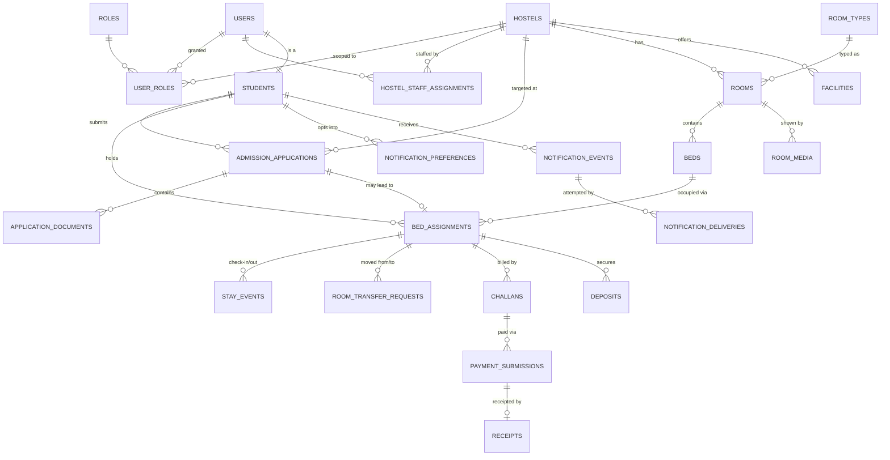
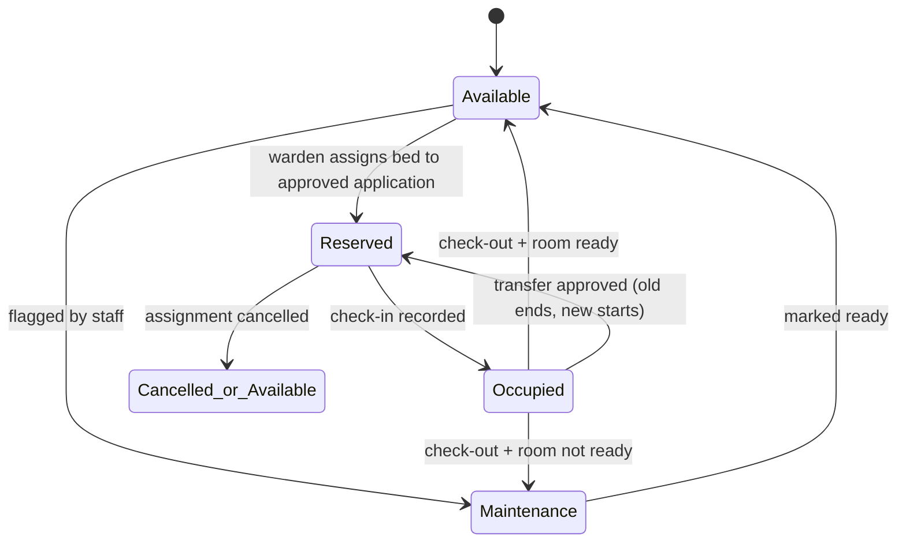
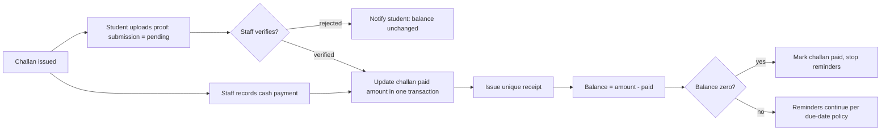

# Entity Relationship Diagram

Status: **Phase 1 draft.** Generated from `database-schema.md`. Diagrams are
Mermaid so they render on GitHub and can be regenerated when the schema changes.
Keep these two files in sync - the schema text is authoritative.

## Core relationships

## Occupancy lifecycle (state, not just tables)

## Money flow (verification is the gate)

## Reading notes for a non-programmer

- "One student can have only one active bed" is drawn as a rule on
  `BED_ASSIGNMENTS`, not on `STUDENTS` - the history of previous beds is kept.
- `PAYMENT_SUBMISSIONS` (what someone claims) and `RECEIPTS` (what the platform
  confirms) are deliberately separate tables. This is what makes "screenshot
  uploaded = paid" impossible by design.
- The public search page reads `availability_snapshot`, but that snapshot is
  rebuilt from real `BEDS` + `BED_ASSIGNMENTS` data every time they change, so
  it can never show an invented number.
